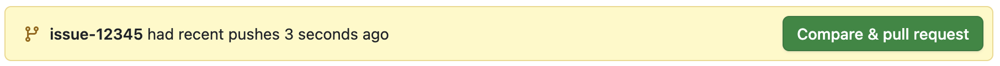
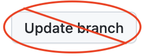

# Making a Pull Request

Contributions to Servo or its dependencies should be made in the form of GitHub pull requests.
Each pull request will be reviewed by a core contributor (someone with permission to land patches) and either landed in the main tree or given feedback for changes that would be required.
All contributions should follow this format, even those from core contributors.

## Pull request checklist

- Branch from the main branch and, if necessary, rebase your branch to main before submitting your pull request.
  If it doesn't merge cleanly with main you may be asked to rebase your changes.

- Run `./mach fmt` and `./mach test-tidy` on your change.

- Commits should be as small as possible, while ensuring that each commit is correct independently (i.e., each commit should compile and pass tests).

- Pull request titles and description must follow Servo's [style guide](style-guide.md#pull-requests).

- Commits should be accompanied by a [Developer Certificate of Origin](http://developercertificate.org) sign-off, which indicates that you (and your employer if applicable) agree to be bound by the terms of the [project license](https://github.com/servo/servo/blob/main/LICENSE).
  In git, this is the `-s` option to `git commit`.

- If your patch is not getting reviewed, or you need a specific person to review it, you can @-reply a reviewer asking for a review in the pull request or a comment, or you can ask for a review in [the Servo chat](https://servo.zulipchat.com/).

- Add tests relevant to the fixed bug or new feature.
  For a DOM change this will usually be a web platform test; for layout, a reftest.
  See our [testing guide](https://github.com/servo/servo/wiki/Testing) for more information.


## Opening a pull request

First, push your branch to your `origin` remote.
Next, either open the URL that is returned by a successful push to start the pull request,
or visit your Servo fork in your web browser and follow the UI prompts.

```
jdm@pathfinder servo % git push origin issue-12345
Enumerating objects: 43, done.
Counting objects: 100% (43/43), done.
Delta compression using up to 12 threads
Compressing objects: 100% (29/29), done.
Writing objects: 100% (29/29), 5.13 KiB | 5.13 MiB/s, done.
Total 29 (delta 25), reused 0 (delta 0), pack-reused 0
remote: Resolving deltas: 100% (25/25), completed with 14 local objects.
remote:
remote: Create a pull request for 'issue-12345' on GitHub by visiting:
remote:      https://github.com/jdm/servo/pull/new/issue-12345
remote:
```



## Addressing review comments

Prefer appending new commits to your branch over amending existing commits.
This makes it easier for Servo reviewers to only look at the changes, which helps pull requests get reviewed more quickly.

```
git commit -s -m "script: Fix deadlock with cross-origin iframes."
git push origin issue-12345
```

## Addressing merge conflicts

When a pull request has merge conflicts, the two most common ways to address them are merging and rebasing.
Please do not press the "Update branch" button on the pull request; this performs a merge and will prevent some Servo CI functionality from working correctly.



Instead, first update your local main branch, then rebase your feature branch on top of the main branch, then force push the changes.

```
git checkout issue-12345
git pull --rebase upstream main
git push -f origin issue-12345
```

When a rebase encounters conflicts, you will need to address them:

```
jdm@pathfinder servo % git rebase main issue-12345
Auto-merging components/script/dom/bindings/root.rs
CONFLICT (content): Merge conflict in components/script/dom/bindings/root.rs
Auto-merging components/script/dom/node.rs
error: could not apply 932c8d3e97d... script: Remove unused field from nodes.
hint: Resolve all conflicts manually, mark them as resolved with
hint: "git add/rm <conflicted_files>", then run "git rebase --continue".
hint: You can instead skip this commit: run "git rebase --skip".
hint: To abort and get back to the state before "git rebase", run "git rebase --abort".
```

Please follow the GitHub documentation for [resolving conflicts](https://docs.github.com/en/get-started/using-git/resolving-merge-conflicts-after-a-git-rebase).

## Running tests in pull requests

When you push to a pull request, GitHub automatically checks that your changes have no compilation, lint, or tidy errors.

To run unit tests or Web Platform Tests against a pull request, add one or more of the labels below to your pull request.
If you do not have permission to add labels to your pull request, add a comment on your bug requesting that they be added.

| Label              | Runs unit tests on | Runs web tests on          |
|--------------------|--------------------|----------------------------|
| `T-full`           | All platforms      | Linux                      |
| `T-linux-wpt`      | Linux              | Linux                      |
| `T-macos`          | macOS              | (none)                     |
| `T-windows`        | Windows            | (none)                     |

The DevTools tests are experimental and not yet enabled by default.
It is highly recommended that pull requests that modify DevTools code run them.
To do so, add the `T-linux-devtools` label.
As with Web Platform Tests, if you do not have permission to add labels, comment to request that it is added.
